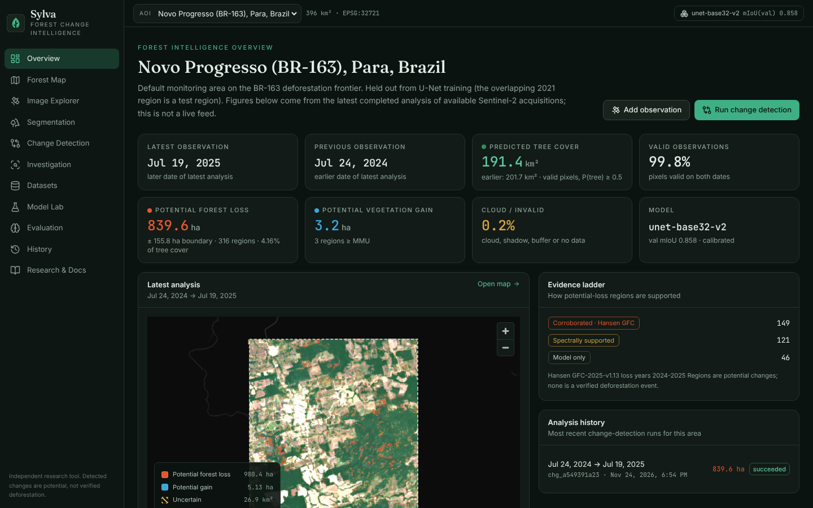
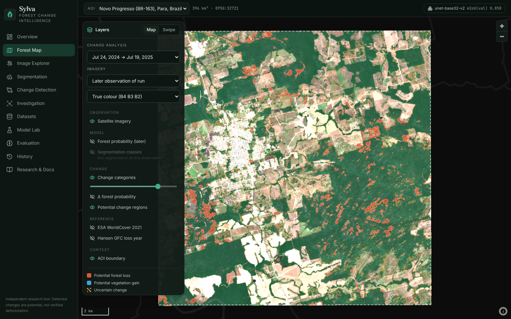
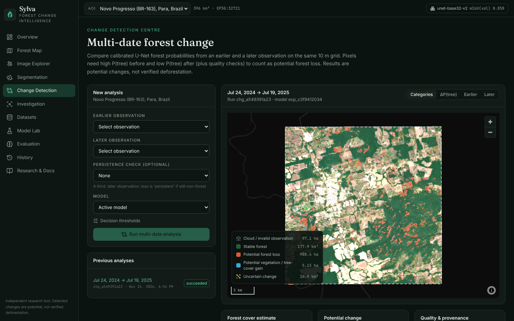
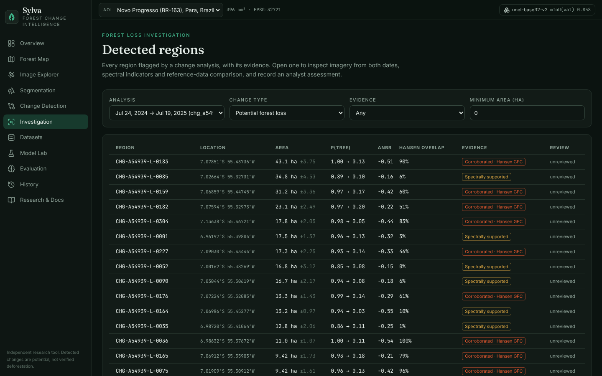
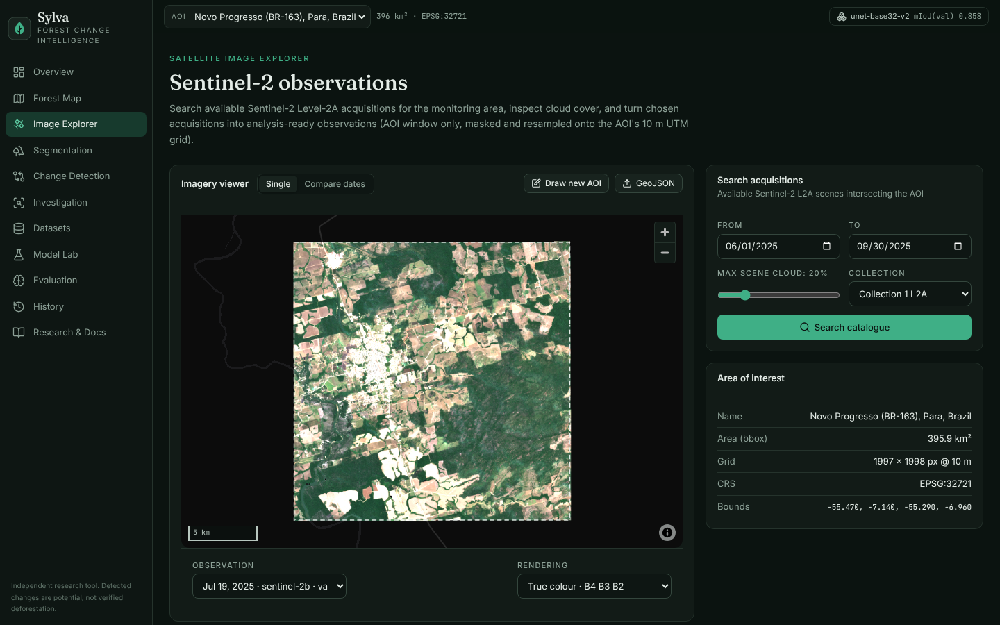
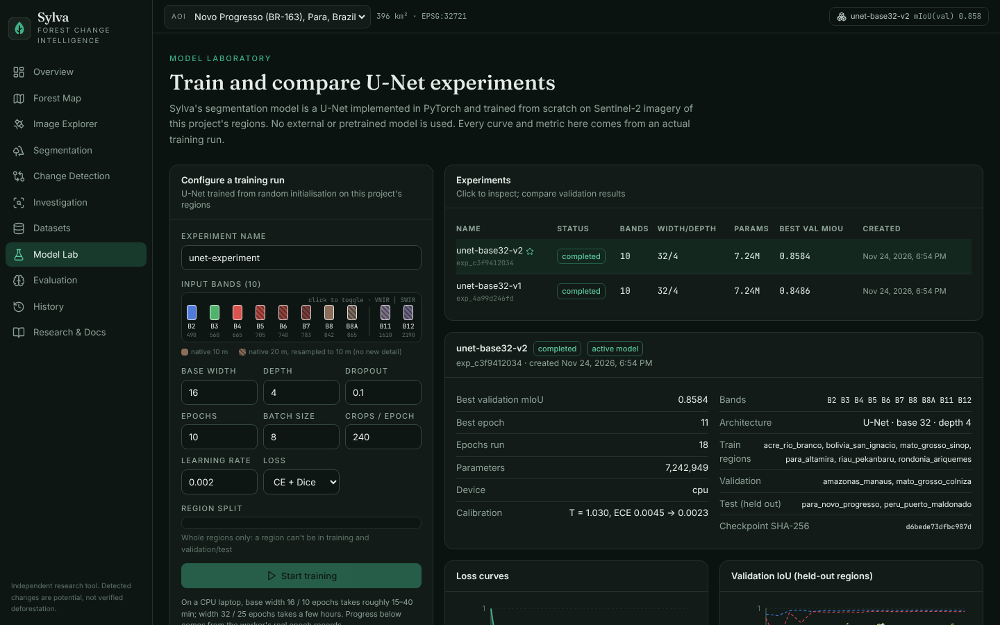

# Sylva: forest change intelligence

Sylva is a locally run research platform. It segments tree cover in **real Copernicus Sentinel-2 Level-2A imagery** with a **U-Net trained from scratch in this repository**, compares observation dates to flag **potential forest-cover loss**, and lets you investigate every detected region on an interactive map.

> Independent educational/research implementation, not affiliated with ESA, NASA or Copernicus. Detected changes are *potential* forest-cover changes, not verified deforestation events; imagery alone cannot establish their cause. Sylva analyses **available acquisitions**; it is not a real-time feed.

| | |
|---|---|
| Frontend | http://localhost:5173 |
| Backend API | http://localhost:8000 |
| API documentation | http://localhost:8000/docs |

## Features

* **Satellite Image Explorer:** search available Sentinel-2 L2A acquisitions for an AOI with a cloud-cover timeline. Ingest single dates (same-day multi-tile mosaics) or median composites as analysis-ready observations; view true colour, false colour, SWIR, NDVI or any single band; swipe-compare dates.
* **Geospatial pipeline:** windowed COG reads (only the AOI is downloaded), radiometric scaling with processing-baseline harmonisation, SCL + cloud-probability masking with a 40 m buffer, a shared UTM 10 m grid, COG outputs with preserved georeferencing.
* **Own U-Net model:** encoder-decoder with skip connections (PyTorch, about 7.2 M parameters), trained from random initialisation on 10 Sentinel-2 bands with weak labels from ESA WorldCover. Region-level train/validation/test split, CE + Dice loss, temperature-scaled calibration.
* **Model Laboratory:** configure bands, architecture, regions and hyper-parameters; train in a background worker with live loss and IoU curves from real epochs; compare experiments; choose the active model.
* **Model Evaluation:** held-out test regions with mIoU, per-class IoU, Dice/F1, precision, recall, confusion matrix, agreement with Hansen GFC, a reliability diagram, and prediction-vs-reference maps.
* **Segmentation Centre:** calibrated P(tree), class and uncertainty maps, a pixel inspector, swipe comparison and GeoTIFF export.
* **Change Detection Centre:** compare two dates (plus an optional persistence date) with editable decision thresholds. Results are categorised (stable forest, potential loss, potential gain, non-forest, uncertain, invalid), vectorised into regions (0.5 ha minimum mapping unit), co-registration checked, and corroborated against Hansen GFC.
* **Forest Loss Investigation:** for every region: coordinates, area ± uncertainty, dates, P(tree) before and after, NDVI/NBR/NDMI, data quality, calibrated confidence, reference comparison, before/after image chips, an evidence ladder and an analyst assessment.
* **Interactive Forest Map:** MapLibre layers for imagery, probability, classes, change categories, ΔP, regions, WorldCover and Hansen loss year, with legends, opacity, swipe mode and a pixel/region inspector.
* **Dataset Explorer, Monitoring History and Research & Docs** pages. Exports (GeoJSON, GeoPackage, CSV, GeoTIFF, bundle) carry a `provenance.json`.

## Screenshots

Captured from a fresh install after `python -m forestwatch.cli sample-data` and one change analysis (24 Jul 2024 → 19 Jul 2025, Novo Progresso, Brazil) with the bundled `unet-base32-v2` model.

| Overview | Forest map |
|---|---|
|  |  |
| **Change detection** | **Forest-loss investigation** |
|  |  |
| **Satellite image explorer** | **Model laboratory** |
|  |  |

## How it works

1. **Acquire**: search the Earth Search STAC catalogue for Sentinel-2 L2A scenes over the area of interest and read only the needed window of each cloud-optimised GeoTIFF.
2. **Prepare**: scale reflectances, harmonise processing baselines, mask cloud and shadow (SCL + cloud probability + 40 m buffer) and resample every date onto one shared 10 m UTM grid.
3. **Segment**: the U-Net turns the 10 bands into calibrated per-pixel probabilities of tree cover (plus other vegetation, bare, water and built-up classes).
4. **Compare**: pixels that were confidently forest on the earlier date and confidently non-forest on the later date (with quality and optional spectral checks) become *potential loss*; they are vectorised into regions of at least 0.5 ha.
5. **Investigate**: each region gets area ± boundary uncertainty, spectral indices, image chips and a comparison with Hansen Global Forest Change, and an analyst can record a review. Results export to GeoJSON, GeoPackage, CSV or GeoTIFF.

## Tech stack

| Layer | Technologies |
|---|---|
| Machine learning | PyTorch (U-Net written from scratch), scikit-learn, NumPy |
| Geospatial | rasterio, rio-tiler, pyproj, shapely, GeoPandas, pyogrio, pystac-client, OpenCV |
| Backend | Python 3.11–3.13, FastAPI, Uvicorn, SQLAlchemy 2 + SQLite (WAL), background job worker, Typer CLI |
| Frontend | React 18, TypeScript, Vite, Tailwind CSS 4, MapLibre GL, Recharts, TanStack Query, Zustand |
| Testing | pytest, Vitest + Testing Library, Playwright |
| Ops | PowerShell setup/start/stop scripts for Windows, bash scripts for Linux/macOS, GitHub Actions CI, Docker recipe for Hugging Face Spaces |

## Windows quick start

Prerequisites: Windows 10/11, **Python 3.11–3.13**, **Node.js 20+**, about 5 GB free disk (more for training data). An NVIDIA GPU is optional.

```powershell
winget install Python.Python.3.12
winget install OpenJS.NodeJS.LTS
```

```powershell
powershell -ExecutionPolicy Bypass -File .\setup.ps1 -WithSampleData
```

```powershell
powershell -ExecutionPolicy Bypass -File .\start.ps1
```

```powershell
powershell -ExecutionPolicy Bypass -File .\stop.ps1
```

`setup.ps1` creates `backend\.venv`, installs PyTorch (a CUDA build is tried automatically if `nvidia-smi` finds a GPU; force with `-Cpu` or `-Cuda`), installs the backend and frontend dependencies, creates `.env`, initialises the SQLite database and runs a smoke check. `-WithSampleData` ingests two real observations (July 2024 and July 2025) of the default AOI, about 80 MB. `-WithTrainingData` builds the training regions, about 1 GB. **No training is ever started automatically.**

`start.ps1` launches the API, the job worker and the frontend in the background, records their PIDs in `.run\pids.json`, waits until they are healthy and opens the browser (`-NoBrowser` to skip, `-Preview` to serve the production build). Logs go to `logs\`. `stop.ps1` stops exactly those process trees and, as a fallback, only processes whose command line is Sylva's.

### First run walkthrough

The U-Nets trained for this project ship in `models/` (`unet-base32-v2` is the default; see `docs/model-card.md`); the default one is registered and activated automatically on first start, so you can analyse imagery immediately (steps 4–6). Steps 1–3 retrain or re-evaluate your own model.

1. **Datasets** → *Build missing* (or `setup.ps1 -WithTrainingData`) to download the training regions.
2. **Model Lab** → configure and *Start training*. The quick profile (width 16, 10 epochs) takes roughly 15–40 minutes on a laptop CPU; then click *Use for analysis*.
3. **Evaluation** → *Evaluate on test regions*.
4. **Image Explorer** → search the AOI, ingest an earlier and a later same-season acquisition (or use `-WithSampleData`).
5. **Change Detection** → choose both observations → *Run multi-date analysis*.
6. **Forest Map / Investigation** → inspect regions; export results.

## Linux/macOS (development)

```bash
cd backend && python3.12 -m venv .venv && source .venv/bin/activate
pip install torch==2.15.0 --index-url https://download.pytorch.org/whl/cpu && pip install -r requirements-dev.txt
cd ../frontend && npm ci && cd .. && cp .env.example .env
./scripts/dev.sh        # starts API, worker and frontend in the background
./scripts/stop.sh       # stops them again
```

Optional: `python -m forestwatch.cli sample-data` (from `backend/` with the venv active) downloads the two sample observations so the Change Detection page has something to compare.

## Data access & credentials

| Source | Credentials |
|---|---|
| Sentinel-2 L2A via Earth Search (AWS Open Data) | **none** |
| ESA WorldCover (public S3) | none |
| Hansen GFC v1.13 (Google Cloud Storage) | none |
| Copernicus Data Space Ecosystem | free account; optional. Set `SYLVA_CDSE_USERNAME` / `SYLVA_CDSE_PASSWORD` in `.env` |
| Dynamic World | Google Earth Engine account; optional. See `scripts/export_dynamic_world.py` |

Credentials live only in `.env` (git-ignored), are read only by the backend and are never sent to the browser. Everything you ingest is cached under `data/`, so training, segmentation and change detection work offline afterwards.

## Command line

```bash
cd backend
python -m forestwatch.cli doctor                  # environment check
python -m forestwatch.cli build-regions           # training data
python -m forestwatch.cli train --config ../configs/training/quick.yaml
python -m forestwatch.cli evaluate ../data/models/<name>/best.pt
python -m forestwatch.cli baselines               # baselines + block-bootstrap intervals on the test regions
python -m forestwatch.cli sample-data             # two observations of the default AOI
```

## Tests

```bash
cd backend && python -m pytest                   # unit, integration (real fixture crops), API workflow
cd frontend && npm test                          # component tests
cd frontend && npx playwright test               # end-to-end (app must be running)
```

The first time, install Playwright's browser with `npx playwright install chromium` (or point `PW_CHROMIUM_PATH` at an existing Chromium). `SYLVA_URL=http://localhost:4173 npx playwright test` runs the same checks against a production build served by `npx vite preview --port 4173`.

Last verified run (2026-11-25, Linux, CPU only): backend 64 passed, 3 skipped (live-provider tests, enabled with `SYLVA_RUN_NETWORK=1`); frontend 8 passed; Playwright 14 passed against both the dev server and the production build; `npm audit` reports 0 vulnerabilities.

## Deploying online (optional)

`scripts/deploy_hf_space.py` packages the app, the bundled models and your local demo data into a Docker-based Hugging Face Space (`deploy/huggingface/`). It needs your own Hugging Face account and token:

```bash
pip install huggingface_hub
export HF_TOKEN=hf_...            # a write token from huggingface.co/settings/tokens
backend/.venv/bin/python scripts/deploy_hf_space.py --repo <your-hf-username>/sylva
```

In the hosted Space the API and the built frontend share one origin, so the interactive API documentation moves from `/docs` to `/api/swagger`.

## Repository layout

```
backend/
  forestwatch/        core library: providers, geo, preprocessing, labels, ml (U-Net), change, pipeline, CLI
  app/                FastAPI app: routers, SQLAlchemy models, job queue + worker, tile service
  tests/              unit, integration, api (+ fixtures: real Sentinel-2 crops)
frontend/             React + TypeScript + Vite + Tailwind + MapLibre + Recharts (11 pages)
configs/              regions.yaml (training split), training/*.yaml
docs/                 methodology, datasets, U-Net, change detection, model card, limitations, reproducibility, references
scripts/              dev.sh, stop.sh, export_dynamic_world.py, deploy_hf_space.py
deploy/huggingface/   Dockerfile + start script for a hosted demo
models/               trained U-Net checkpoints (v1, v2) and the DEFAULT pointer
setup.ps1 start.ps1 stop.ps1
CHECKLIST.md          development checklist and acceptance status
```

## Documentation

See `docs/` (also rendered in the app under *Research & Docs*): [overview](docs/overview.md), [methodology](docs/methodology.md), [Sentinel-2](docs/sentinel2.md), [U-Net](docs/unet.md), [change detection](docs/change-detection.md), [datasets](docs/datasets.md), [model card](docs/model-card.md), [limitations](docs/limitations.md), [reproducibility](docs/reproducibility.md), [references](docs/references.md).

## Limitations

* Detected regions are **potential** forest-cover changes, not verified deforestation; the cause of a change cannot be determined from imagery alone.
* Training labels are weak labels derived from ESA WorldCover, so metrics measure agreement with a reference map, not with field ground truth. The bare/sparse class is weak (F1 0.31–0.32 with v2).
* The test set is two regions. On the rebuilt test regions the U-Net reaches mIoU 0.715 [95% block-bootstrap CI 0.690–0.735] against 0.657 for a per-pixel classifier and 0.129 for "tree cover everywhere"; v1 and v2 are not distinguishable (see the [model card](docs/model-card.md#baselines-and-uncertainty-2026-11-25-same-rebuilt-test-regions)). The intervals ignore seed and between-region variability, so they understate the real uncertainty.
* Areas are mapped areas with boundary uncertainty; sample-based (Olofsson) area estimation is not implemented.
* Sylva analyses archived acquisitions; it is not a real-time alerting system. Cloudy seasons reduce the usable observations.
* The CDSE authenticated download, Dynamic World labels and the CUDA/GPU path are implemented but not verified (they need accounts or a GPU).

Full details: [docs/limitations.md](docs/limitations.md) and [CHECKLIST.md](CHECKLIST.md).

## License

Source code: [MIT](LICENSE). Data products keep their own licences (below).

## Attribution

Contains modified Copernicus Sentinel data (2021–2025). ESA WorldCover © ESA WorldCover project, CC BY 4.0. Hansen/UMD/Google/USGS/NASA Global Forest Change, CC BY 4.0. Basemap: OpenFreeMap, © OpenMapTiles, © OpenStreetMap contributors.
